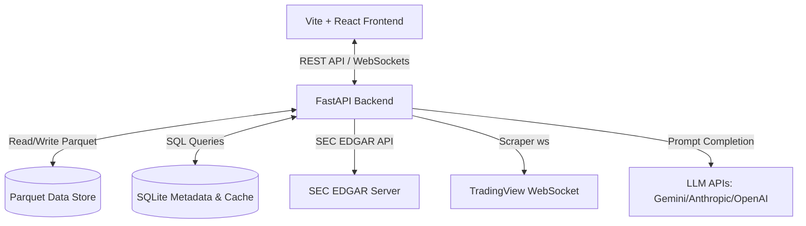

# SEC Offering & Dilution Analyzer

A modern, high-performance financial analytics web application designed to parse, extract, and analyze SEC EDGAR filings for public companies. It tracks dilution instruments (ATM offerings, shelf registrations, warrants, convertible debt/preferred shares, and ELOCs), displays real-time price charts, and uses advanced LLMs (Gemini, Anthropic, OpenAI) to generate dilution risk recommendations.

---

## Key Features

### 1. SEC Filings Extraction & Parsing
* **Automated Downloads**: Pulls SEC filings directly from EDGAR and caches them in a local SQLite database.
* **iXBRL Integration**: Prefers structured Inline XBRL (iXBRL) parsing to fetch cash positions, shares outstanding, and convertible notes principal amounts with maximum accuracy.
* **Filing Classifiers**: Parses and extracts terms for:
  * **ATM (At-The-Market) Offerings**: Active capacities, placement commissions, and agents.
  * **Shelf Registrations (S-3/F-3)**: Registrations, S-1 offerings, and lock-up terms.
  * **Warrants & Convertible Notes**: Issuance dates, interest rates, conversion prices, and exercise prices.
  * **Equity Lines (ELOC)**: Counterparties (e.g., Yorkville, Lincoln Park), floor prices, and discount VWAP pricing.
  * **Completed Offerings**: Completed share sales and pricing.

### 2. TradingView Chart & Real-Time Prices
* **Market Feed**: Fetches historical OHLCV data using the `tradingview-scraper` WebSocket library.
* **Real-time Candle Updates**: Streams live ticking bars using background tasks via FastAPI WebSockets.
* **Exchange Resolution**: Resolves tickers to their TV exchanges (`NASDAQ`, `NYSE`, `AMEX`) using Yahoo Finance search API.
* **Auto-Pagination**: Listen to visible range changes; scrolling back lazy-loads older history.
* **Filing Levels Plotting**: Renders filing-derived pricing thresholds within +/- 100% of the current price as solid horizontal lines (Warrants, Notes, Preferreds, ELOC floors).
* **Price Refresh**: A refresh button reloads market data and WebSocket feeds without clearing the levels.

### 3. AI Recommendation & Prediction Engine
* **Context Prompting**: Gathers all extracted records, formats them to CSV, and builds a comprehensive prompt containing runway, burn rates, baby-shelf limits, price stickiness, and toxic covenants.
* **LLM Providers**: Supports Gemini (Google), Claude (Anthropic), and GPT (OpenAI) models.
* **Chart Target Overlays**: Instructs the LLM to output key support/resistance zones and squeeze targets in a structured JSON format. The frontend:
  1. Parses the JSON.
  2. Plots targets as dashed horizontal lines (Support in Green, Resistance in Red, Squeeze in Blue).
  3. Strips the JSON block from the rendered Markdown report for a clean UI.
* **Per-Ticker Cache**: Caches reports and levels in `localStorage`, restoring them instantly when switching tickers.

### 4. Interactive UX
* **Sidebar Toggle**: Collapse the Left Control Panel ("Show/Hide Control Panel") to expand the Explorer panel and maximize screen space.
* **Draggable Resizer**: Vertical drag handle at the bottom of the chart to adjust its height dynamically between `200px` and `1000px`.

---

## System Architecture

The application is split into a **Python FastAPI** backend and a **Vite React TypeScript** frontend:



### Backend Components
* **`backend/main.py`**: FastAPI server hosting REST routes (`/chart/history`, `/chart/levels`, `/recommendation`) and WS channels (`/ws/chart/{ticker}`).
* **`backend/services/`**:
  * `exchange_resolver.py`: Yahoo Finance ticker mapper.
  * `recommendation_service.py`: LLM calling, prompt compiler, CSV serializer, and database levels filter.
  * `sec_downloader.py` & `sec_xbrl_api.py`: SEC Facts client & cache.
  * `ixbrl_extractor.py`: Inline XBRL extractor.
  * `parquet_io.py`: Local Parquet read/write utilities.
* **`backend/extractors/`**: File-specific heuristics and regex parsers for warrants, ATMs, ELOCs, etc.
* **`backend/pipeline.py`**: Aggregator that runs all parsers sequentially on downloaded filings.

### Frontend Components
* **`frontend/src/App.tsx`**: Contains the main React application layout, states, and the `TradingViewChart` lightweight-chart wrapper.
* **`frontend/src/index.css`**: Styling tokens, grids, layout options, and Markdown table style configurations.

---

## Installation & Setup

### Prerequisites
* Python 3.10+
* Node.js v18+
* npm or yarn

### 1. Install & Run Backend
1. Navigate to the root directory.
2. Install the Python dependencies:
   ```bash
   pip install -r backend/requirements.txt
   ```
3. Run the backend server using Uvicorn:
   ```bash
   python -m uvicorn backend.main:app --reload --host 127.0.0.1 --port 8000
   ```
   *(Or double-click `run_backend.bat` on Windows)*

### 2. Install & Run Frontend
1. Navigate to the `frontend` folder:
   ```bash
   cd frontend
   ```
2. Install the JavaScript packages:
   ```bash
   npm install
   ```
3. Start the Vite development server:
   ```bash
   npm run dev
   ```
   *(Or double-click `run_frontend.bat` on Windows)*
4. Open the application in your browser at `http://localhost:5173`.

---

## Usage Guide

1. **Run Analysis**: Enter a ticker (e.g., `POLA`) on the left panel, configure the data store root and date range, and click **Run Analysis Pipeline**. Wait for progress bars to hit 100%.
2. **Explore Tabs**: Click between "ATM Offerings", "Warrants", "Convertible Notes", etc., to review tabular results of parsed filings.
3. **Toggle Control Panel**: Click **Hide Control Panel** in the top header to hide the sidebar and give the explorer maximum horizontal width.
4. **AI recommendation**:
   * Navigate to the **AI Recommendation** tab.
   * View the TradingView chart loading 5-minute price bars. Drag the bottom resizer handle to make it larger/smaller, or select different timeframes (e.g., `1h`, `1d`).
   * Verify solid lines showing outstanding warrants or notes.
   * Input your LLM provider details, model key, and stock context.
   * Click **Generate AI Recommendation**.
   * When finished, the report displays clean markdown, and dashed target lines (AI resistance, support, and squeeze zones) automatically overlay the price action.
   * Switch to another ticker and back to see your report and target levels restored instantly.
